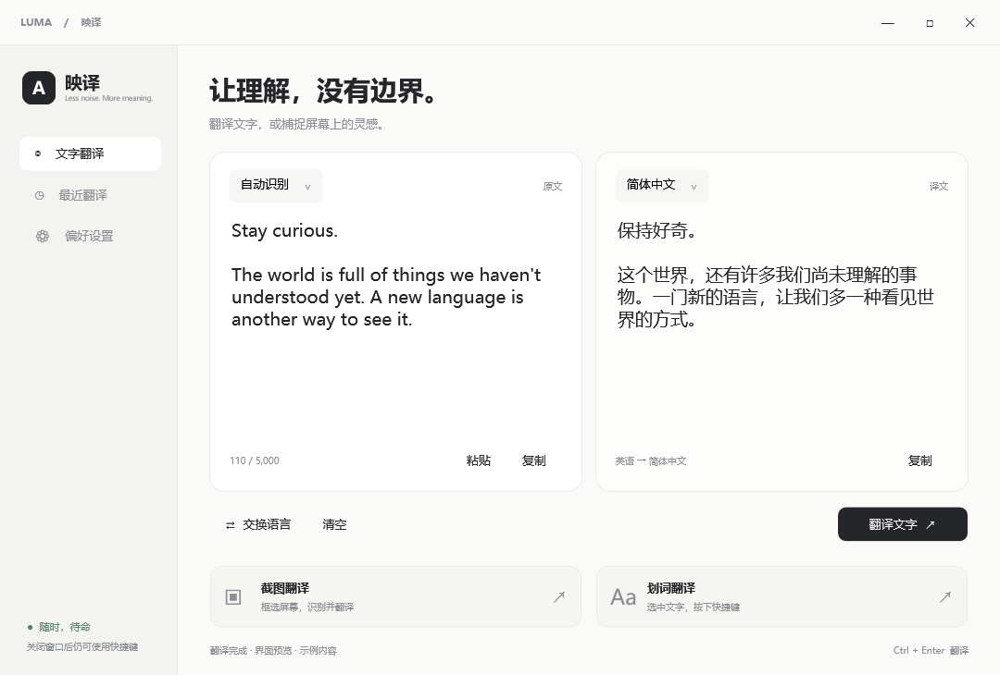

# 映译 Luma

一款原生 Windows 桌面翻译应用。暖白界面、石墨色按钮、简洁的双栏排版，以及随用随开的双语浮窗。



## v1.1 更新

- 截图和划词浮窗的原文现在可以直接修正或重新输入，浮窗内可切换原文／目标语言，并可点击「翻译」或按 `Ctrl + Enter` 再次翻译。
- 译文也可以手工修改后复制。修改原文或语言会取消尚未完成的旧请求，旧结果不会回来覆盖新内容。
- 浮窗标题区可直接拖动，仍支持调整大小和置顶。浮窗出现时不主动抢走当前应用的焦点；点击浮窗后即可输入。
- 截图遮罩采用不激活窗口，不调用外部窗口的最小化、隐藏或移动操作；取消截图时也不会把原本在后台的映译窗口强行带到前台。
- 截图路径移除了固定的 35 + 90 毫秒等待，并改为直接处理 BGRA 像素；1920 × 1080 测试中，图像准备中位耗时从 17.54 ms 降至 3.00 ms。该数据不包含 OCR 和网络。
- 长文本最多并行处理 3 个翻译分段，重复分段与同时发生的相同请求会合并；短文本仍取决于公共翻译服务的网络响应速度。

## 直接使用

1. 如果收到的是 ZIP，先将整个压缩包解压到一个文件夹。
2. 双击 `LumaTranslate.exe`。运行成品不需要安装 Python、Node.js、Visual Studio 或 .NET SDK。
3. 在左侧输入文字，选择原文与目标语言，点击「翻译文字」或按 `Ctrl + Enter`。
4. 默认关闭主窗口后继续留在 Windows 右下角系统托盘。点击小箭头可找到图标，双击图标重新打开；右键菜单可截图、打开设置或彻底退出。

适用环境：**Windows 10 / 11，x64，.NET Framework 4.8**。截图识别需要相应 Windows OCR 语言组件。应用无需管理员权限。请保留同目录的 `LumaTranslate.exe.config` 和 `assets` 文件夹。

## 快捷键

| 操作 | 默认快捷键 | 使用方法 |
| --- | --- | --- |
| 截图翻译 | `Ctrl + Alt + A` | 按快捷键，拖动框选屏幕文字，松开鼠标；识别和翻译后显示中央浮窗。 |
| 划词翻译 | `Ctrl + Alt + D` | 先在浏览器、编辑器等应用中选中文字，再按快捷键并松开。 |
| 主窗口翻译 | `Ctrl + Enter` | 翻译当前输入；翻译期间再次触发会取消。 |
| 浮窗重新翻译 | `Ctrl + Enter` | 修改浮窗原文或语言后重新翻译；翻译期间再次触发会取消。 |
| 取消截图 | `Esc` 或鼠标右键 | 退出框选，恢复之前的应用窗口。 |
| 关闭翻译浮窗 | `Esc` | 关闭浮窗，应用继续驻留后台。 |

在「偏好设置」中点击快捷键输入框，再直接按下新组合键，点击「保存偏好」立即生效。两个动作不能使用相同快捷键；若与其他应用冲突，会给出提示并保留原来的快捷键。`Ctrl + Alt + A` 可能被其他截图软件占用，可改为 `Ctrl + Shift + A` 等组合。

点击主界面的「划词翻译」会收起主窗口，给你 3 秒钟切换并选中文字。日常使用全局快捷键更方便。

## 已实现的功能

- 原生 WPF 桌面主窗口，支持拖动、调整大小、最大化和最小化。
- 中文、英文、日文、韩文、法文、德文、西班牙文、俄文互译；可交换语言与文字。
- 原文粘贴、原文复制、译文复制、清空，单次最多 5,000 字符。
- 后台系统托盘、单实例运行、重复打开时唤醒已有窗口。
- 可修改的全局截图 / 划词快捷键，冲突检查与回滚。
- 屏幕框选遮罩、区域裁剪、Windows 本地 OCR。
- 屏幕中央双语浮窗，原文／译文均可编辑和分别复制，可在浮窗切换语言、重新翻译、调整大小、拖动、置顶及失败重试。
- 最近 50 条翻译记录，点击重新查看，可清空。
- 关闭后驻留托盘、启动时直接进入托盘、默认目标语言等偏好。
- 请求取消、超时、网络错误、免费额度限制和损坏本地文件的错误处理。
- 修改原文或语言后清除旧译文，避免旧结果与新语言标签不一致；取消的旧请求不会覆盖新结果。

## 在线服务与数据

默认使用 **MyMemory**，无需 API Key。它是有免费用量限制的公共在线服务，不是无限量或离线翻译；译文质量、可用性和额度由服务方决定。实现遵循 [MyMemory 官方 API 说明](https://mymemory.translated.net/doc/spec.php)：每次请求最多 500 UTF-8 字节，长文本按段安全拆分后翻译，并保留原文段落及空白布局。

截图在本机通过 Windows OCR 识别，**图片不会上传**；原文（包括识别或划词得到的文字）会经 HTTPS 发送给 MyMemory 进行翻译。程序使用查询接口，不调用向公共语料贡献翻译的 `/set` 接口。参阅 [MyMemory 服务条款](https://mymemory.translated.net/terms-and-conditions)。

设置和历史记录保存在 `%LOCALAPPDATA%\LumaTranslate` 的 JSON 文件中，未加密。截图不会自动保存到磁盘。历史可在应用内清空；退出后删除该数据目录可重置全部偏好。内存翻译缓存最多 32 项，10 分钟过期，退出后释放。

「自动识别」是按文字特征判断：汉字、假名、韩文和西里尔文字分别推定为中文、日文、韩文、俄文；其他文字默认英文。法文、德文、西班牙文、纯汉字日文或其他西里尔语言请手动选择。若原文和目标语言相同，会显示原文并标明同语种，请切换目标语言。

## 截图与划词注意事项

- Windows OCR 依赖已安装的识别语言。在 Windows「设置 → 时间和语言 → 语言和区域 → 语言选项」中检查相应识别组件。本机验证时已安装 `en-US` 和 `zh-Hans-CN`。识别语言沿用主界面原文语言；自动模式使用 Windows 用户语言设置。[微软 OCR 文档](https://learn.microsoft.com/en-us/uwp/api/windows.media.ocr.ocrengine.trycreatefromuserprofilelanguages)
- 划词优先读取应用提供的辅助功能选择信息，必要时模拟 `Ctrl+C`。读取后会尝试恢复原剪贴板；若用户已复制新内容，则保留新内容。
- 禁止复制、未提供文字选择信息、以更高权限运行的窗口可能无法直接划词；可改用截图翻译。
- OCR 会受字体、清晰度、背景、方向和语言组件影响，必要时重新框选或复制原文到主窗口修正。
- 截图遮罩和结果浮窗默认不抢焦点，以免独占全屏应用因失焦而自行最小化。浮窗出现后单击它即可编辑；用户主动点击浮窗时，Windows 会按正常规则切换焦点。
- 已实现多屏物理坐标和 DPI 感知；混合缩放多屏的实际拖动仍需在对应设备上验收。
- 托盘图标位于小箭头内还是直接显示在任务栏，由 Windows 的托盘显示设置控制。
- 当前版本没有加入开机自启；「启动时直接进入托盘」指你手动启动应用时不弹主窗口。

## 验证状态

已在当前 Windows 机器完成编译、界面渲染、真实本地 OCR、快捷键注册与冲突回滚、可编辑浮窗状态、核心翻译逻辑和托盘资源释放测试。25 组核心测试与 32 项原生检查全部通过；真实 MyMemory 接口也已通过独立 HTTPS 客户端返回中英译文。

**尚未完成：普通桌面会话下应用自身的真实联网翻译，以及实际独占全屏应用、鼠标框选、跨应用划词和混合 DPI 多屏交互验收。** 当前受限执行环境中的 Windows HTTPS / .NET 请求返回「安全包中没有可用的凭证」，因此没有把应用内联网链路标记为已验证。详细证据、复测方法见 `TESTING.md`。预览图是实际 WPF 界面的离屏渲染，其中的翻译文字为界面演示内容。

## 从源码构建

源码位于 `src`。使用系统 C# 编译器，无 NuGet 包依赖。

构建需要 .NET Framework 4.8 Developer Pack 和 Windows 10 SDK（提供 `Windows.winmd`）。这些仅为开发依赖，运行已编译的 EXE 不需要安装。

```powershell
powershell.exe -NoProfile -ExecutionPolicy Bypass -File .\build.ps1
```

可选调试构建：`-Configuration Debug`。也可以用 Visual Studio 打开 `src\LumaTranslate.csproj`。构建脚本会自动查找已安装的 Windows SDK。

```text
LumaTranslate.exe             应用
LumaTranslate.exe.config      运行配置
assets/luma.ico              应用与托盘图标
src/App.cs                  入口、托盘、窗口生命周期与请求协调
src/UI.cs                   主窗口、历史、设置与双语浮窗
src/Native.cs               全局快捷键、划词、截图与 OCR
src/Services.cs             翻译请求、分段、缓存、设置和历史
tests/                      可复测的自动检查
preview/                    实际界面的演示预览
```

发行包为本地构建的免安装版本，尚未进行代码签名或制作安装程序。

